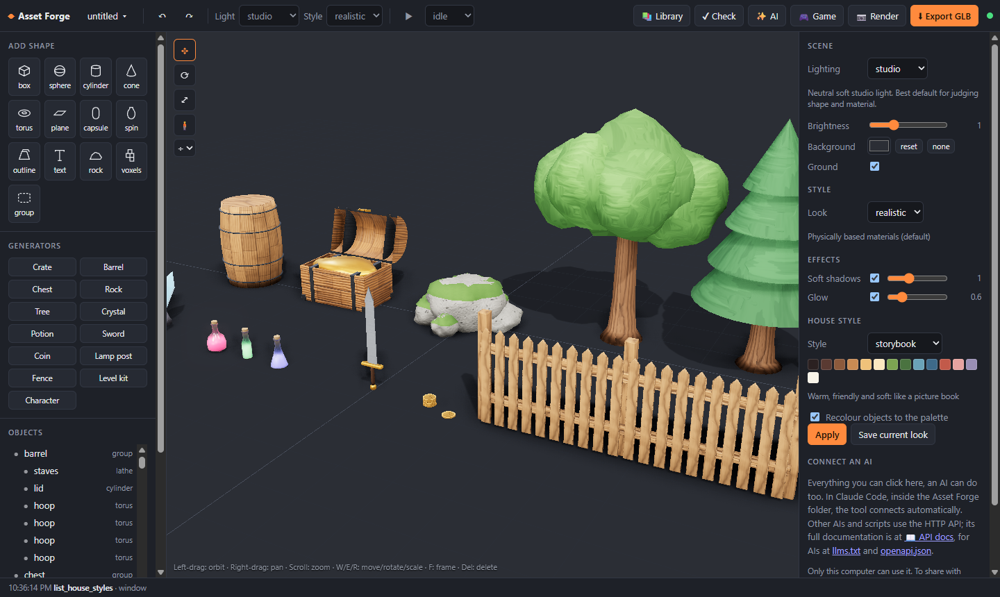
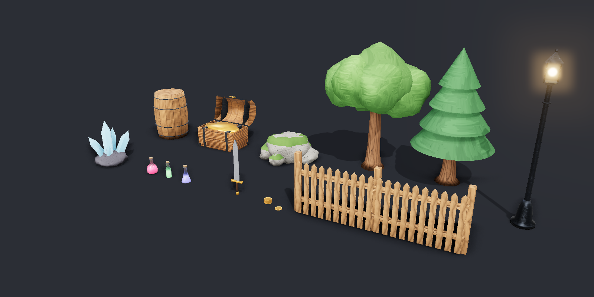
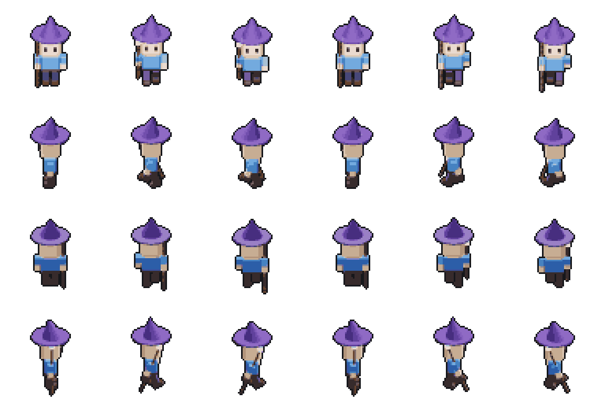

<div align="center">

# ⚒️ Asset Forge

**A 3D and pixel-art asset workshop that AI can drive completely.**

Tell an AI what you want — *"a wooden treasure chest, a bit old, with gold inside"* — and watch it get built live.
Then export it straight into your game.



[What it is](#what-it-is) · [Quick start](#quick-start) · [Connect an AI](#connect-an-ai) · [Features](#features) ·
[API docs](#documentation) · [Extend it](#extend-it)

</div>

---

## What it is

Asset Forge is a small, friendly cousin of Blender, made for **game assets**: props, characters, level pieces,
sprites, icons, tiles and effects. Its key difference: **every single thing it can do is a command that an AI can
call**. That works for Claude, ChatGPT, local models, scripts, and you, clicking in the window.

- 🎨 **Beautiful by default.** Soft shadows, glow, generated wood, metal and stone materials, ageing and wear, and several looks (realistic, toon, low-poly, clay).
- 🤖 **Built for AI.** 107 commands, available through MCP, HTTP, OpenAPI and a command line. The AI can *look* at its own work with `render_preview`.
- 🎮 **Game-ready.** Exports straight into Godot 4 (collision, animations, SpriteFrames, TileSets), and as `.glb`, `.png` and `.aseprite`.
- 👾 **Pixel art too.** It can turn any 3D model into crisp pixel-art sprite sheets from 4 or 8 directions, with palettes and outlines.
- 🧩 **Expandable.** Drop a plugin in a folder and its new commands appear everywhere at once.

Asset Forge is **not a game engine**: it makes the pieces, and your game engine puts them together.

<table>
<tr>
<td width="60%"></td>
<td width="40%"></td>
</tr>
<tr>
<td align="center"><sub>Every prop above came from one command each (with a seed for endless variations)</sub></td>
<td align="center"><sub>A 3D character rendered as a pixel-art walk cycle, 4 directions</sub></td>
</tr>
</table>

## Quick start

**You need:** [Node.js](https://nodejs.org) 20 or newer, and Google Chrome or Microsoft Edge (used invisibly to draw pictures).

```bash
git clone https://github.com/jackdamnielzz/asset-forge.git
cd asset-forge
npm install
npm start
```

The window opens at **<http://127.0.0.1:7777>**. Everything you make is saved automatically.

**On Windows**, there are easier options:

| File | What it does |
|---|---|
| `Install Asset Forge.bat` | Adds an **Asset Forge** icon to your desktop and Start menu; it opens in its own window like a normal program |
| `Start Asset Forge.bat` | Starts Asset Forge right away, in your browser |
| `Share Asset Forge.bat` | Lets other computers on your network use it, protected by a password you choose |

## Connect an AI

| Who | How |
|---|---|
| **Claude Code** in this folder | Nothing to do: `.mcp.json` connects it automatically. Just ask: *"make a fantasy potion shop counter"* |
| **Claude Code** anywhere | `claude mcp add asset-forge -- node /path/to/asset-forge/src/mcp/index.js` |
| **Claude Desktop, Cursor**, other MCP apps | Add an MCP server with command `node`, argument `/path/to/asset-forge/src/mcp/index.js` |
| **ChatGPT actions, LangChain, n8n**, … | Import `http://127.0.0.1:7777/api/openapi.json` |
| **Any AI or script** | HTTP: `POST /api/commands/<name>` with a JSON body |
| **Terminal** | `node src/cli/forge.js add_object type=box` |

A tip for any AI: tell it *"Read http://127.0.0.1:7777/llms.txt first"*. That one page teaches it everything.

```bash
curl -X POST http://127.0.0.1:7777/api/commands/make_chest -H "Content-Type: application/json" -d "{\"open\":true,\"wear\":0.4}"
```

Every answer looks like `{ "ok": true, "result": … }`. Pictures come back as base64, or as a real PNG with `?format=png`.

## Features

<details open>
<summary><b>🧱 Modelling</b></summary>

- Shapes: box with rounded edges, sphere, cylinder, cone, torus, plane, capsule, **spin** (bottles, vases), **outline** (blades, signs), **3D text**, **rock**, **voxels** and **picture → 3D**
- Cut holes, melt shapes together or keep only the overlap; mirror; repeat in a line, circle or grid
- Groups, multi-select, move, rotate and scale handles, grid snapping, unlimited undo
- A see-through 1.8 m person to check sizes
</details>

<details open>
<summary><b>✨ Looks</b></summary>

- 26 material presets, including generated, seamless materials: oak, old wood, planks, brushed and rusty metal, stone, brick, tiles, fabric and hand-painted
- `wear` from 0 to 1 adds grime, scratches, faded colour and worn edges
- 6 lighting moods, soft contact shadows, glow, and scene looks: realistic, toon, low-poly, clay
- House styles give a whole project one palette and look (storybook, dark fantasy, retro pixel, or your own)
</details>

<details open>
<summary><b>🏭 Generators</b> — complete assets from one command</summary>

Crate, barrel, chest, rock, tree, crystal, potion, sword, coin, lamp post, fence, a character with animations, and
level kits (dungeon, cottage, sci-fi). Each one has options and a seed.
**Recipes** remember how something was made, so you can say *"the same chest, but older"* (`remake`);
**variations** build several versions side by side to pick from.
</details>

<details>
<summary><b>🎮 Games and Godot</b></summary>

- Animations: presets (spin, bob, pulse, swing, hinge, shake, hop) or your own keyframes, baked into the GLB
- `export_godot` writes straight into a Godot 4 project, with collision shapes and an AnimationPlayer
- Godot **SpriteFrames** and **TileSet** files, ready to use
- Tested in real Godot 4.6: `npm run test:godot`
</details>

<details>
<summary><b>👾 Pixel art and 2D</b></summary>

- Sprite sheets from 1, 4 or 8 directions, with palettes (PICO-8, Endesga 32, Game Boy …), dithering, outlines and normal maps for 2D lights
- Inventory icons, prop sheets, isometric tiles and autotiling ground tilesets
- Effects (explosion, fire, magic, lightning …), parallax backgrounds, a pixel editor with frames
- Colour tools: recolour, palette variants, steal a palette from a picture, a pixel-style checker
- Import MagicaVoxel `.vox`; export `.aseprite`
</details>

<details>
<summary><b>🤖 Outside AI services</b> (optional, you use your own key)</summary>

| Service | Makes |
|---|---|
| OpenAI (gpt-image) | Pictures, edits, transparent backgrounds |
| Google Gemini (Nano Banana) | Pictures and edits |
| NanoGPT | Pictures and videos from many models |
| fal.ai (Trellis, Hunyuan 3D) | 3D models from a picture or text |
| PixelLab | **Every** PixelLab tool with all its settings: characters, animations, tilesets, UI, fonts … |

Keys stay on your computer (`workspace/secrets.json`) and are never sent back through the API.
These services cost money, so AIs are told to ask you first.
</details>

<details>
<summary><b>🛟 Safety and comfort</b></summary>

- Saves after every change, version history and checkpoints, and a daily backup (the last 7 are kept)
- A quality check finds floating parts, odd sizes, heavy models and more, each with a fix
- An asset library with thumbnails, tags and search
- Protection against other websites and unknown hosts; a password when sharing
</details>

## Documentation

Everything is generated from the software itself, so it is always complete: every command and every setting is explained.

| | For | Live (while Asset Forge runs) |
|---|---|---|
| [llms.txt](llms.txt) | AIs: a short guide plus every command | `/llms.txt` |
| [docs/API.md](docs/API.md) | Everyone: every command with all its settings and an example | `/docs` (searchable) |
| [docs/openapi.json](docs/openapi.json) | Tools: OpenAPI 3.1 | `/api/openapi.json` |
| [AGENTS.md](AGENTS.md) | AI coding agents: where to start | — |
| [PLAN.md](PLAN.md) | The vision and roadmap | — |

## Extend it

A plugin is one folder. Create `plugins/my-plugin/index.js`:

```js
export const description = 'What it does';
export default function register({ registry, z, engine }) {
  registry.define({
    name: 'make_pillar',
    description: 'A stone pillar. Explain it as an instruction: AIs read this.',
    input: z.object({ height: z.number().optional().describe('Height in metres') }),
    async handler(args, ctx) {
      return engine.execute('add_object', {
        type: 'box', params: { width: 0.4, height: args.height ?? 2, depth: 0.4, bevel: 0.03 },
        material: { preset: 'cobblestone' },
      }, ctx.meta);
    },
  });
}
```

Restart, and `make_pillar` appears in the window's API, the MCP tools, the command line and the docs.
See [plugins/crate](plugins/crate) and [plugins/props](plugins/props) for full examples.

<details>
<summary><b>For developers</b></summary>

```
src/core/      the engine: scene, commands, undo, history, saving, docs
src/server/    HTTP API, live link to windows, hidden renderer, access control
src/mcp/       the MCP server for Claude and other AI apps
src/cli/       command line
src/shared/    presets, palettes and animations used by engine and window
web/           the window (three.js, no build step)
plugins/       add-ons; each folder is one plugin
docs/          generated API docs
test/          npm test (end-to-end) and npm run test:godot
workspace/     your projects, library and exports (not in git)
```

- `npm test` runs the end-to-end check; it fails if a command or setting is not explained.
- `npm run docs` refreshes `llms.txt` and `docs/` after changing commands.
- Architecture rules are in [CLAUDE.md](CLAUDE.md).
</details>
